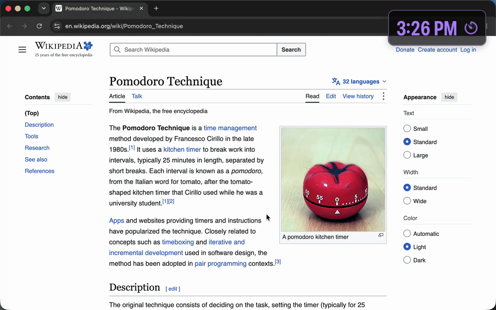

# SpaceClock: Floating Clock & Timer for Mac

**A free, open-source, always-on-top clock and countdown timer for macOS.** It floats above every window, follows you across every desktop when you three-finger swipe, and stays visible over full-screen apps, PDFs and slides.

Built for studying and deep work: one glance at the corner of your screen tells you the time or how long is left, without leaving what you're doing.

<p align="center">
  
</p>

<p align="center"><sub>Real recording on macOS: the clock floats over Chrome, gets dragged around, starts a 1-minute timer, stays on top when switching to a PDF in Preview, changes color, and flashes when time's up. The middle section is sped up 9×.</sub></p>

## Why SpaceClock?

macOS has no built-in way to keep a clock or timer visible on top of everything. The menu bar clock disappears in full-screen apps, and most timer apps hide behind your windows or stay on one desktop. SpaceClock fixes that:

- **Always on top.** Floats above every app, including full-screen apps, browsers, PDFs and slides.
- **Follows you across Spaces.** Swipe between desktops with three fingers (or Ctrl ← / →) and the clock comes with you.
- **Never steals focus.** Clicking it doesn't pull you out of what you're typing, and it has no Dock icon.

## Features

### ⏱ A floating timer for yourself

Click the **⏱** button on the clock and pick a time from **1 to 60 minutes**, or choose **Custom…** and type any duration (`7`, `2:30`, `1h 15m`, `90s`). The countdown replaces the clock, with the current time shown small underneath.

- Double-click to **pause or resume**.
- **Restart** or **stop** from the ⏱ menu.
- When time is up, the window **flashes red and chimes**. Click it to dismiss.

It works well as a **Pomodoro timer** (use the 25-minute preset), an exam-practice timer, a presentation timer or a break reminder.

### 🎨 Color-changing text that keeps catching your eye

When something sits on screen all day, your eyes stop noticing it. SpaceClock fights that: the text **changes color every 22 seconds**, cycling through cyan, lime, pink, yellow, violet and mint, with a brief border pulse on each change. The movement keeps pulling your attention back to the time.

Prefer a calm clock? Right-click → untick **Change Color Every 22s**.

### ✋ Drag it from anywhere

Grab the clock **anywhere on its surface** (the numbers, the background, the edges) and drag it wherever you like. It remembers its position, even after a restart. Use **Lock Position** to stop accidental moves, or **Move to Top Right** to reset it.

### More

- **Sizes:** Small, Medium, Large and Huge. The tall, condensed digits stay readable from across the room.
- **Opacity:** 100%, 85%, 60% or 40%.
- **12- or 24-hour time**, optional seconds and date.
- **Launch at Login.**
- **Tiny and private:** a single Swift file with no dependencies, no network access and no tracking.

## 🍎 Made for Mac

SpaceClock is a **native macOS app**, written in Swift with Apple's AppKit. It isn't a web wrapper or a cross-platform port, so it uses almost no memory or battery and behaves like a proper Mac app.

Good floating clocks and always-on-top timers are surprisingly hard to find for Mac. If you've been searching for any of these, this is for you:

- floating clock for Mac / macOS desktop clock widget
- always-on-top timer for macOS
- clock that stays visible in full-screen apps on Mac
- countdown timer overlay for Mac
- clock that shows on all desktops (Spaces) on Mac
- Pomodoro or study timer that floats over other windows

Requires **macOS 13 Ventura or later** (Ventura, Sonoma, Sequoia, Tahoe), and builds natively for Apple Silicon or Intel, whichever Mac you build it on. Developed and tested on macOS 26 Tahoe; reports from other versions are welcome.

> SpaceClock is Mac-only. It relies on macOS features such as Spaces, full-screen auxiliary windows and AppKit panels, so it won't run on Windows or Linux.

## Install

You need **macOS 13 or later** and Apple's Command Line Tools, which provide the Swift compiler. If you don't have them, run this first:

```sh
xcode-select --install
```

Then:

```sh
git clone https://github.com/dsatyam09/SpaceClock.git
cd SpaceClock
./build.sh
open ~/Applications/SpaceClock.app
```

`build.sh` compiles the app and installs it to `~/Applications/SpaceClock.app`. Because you build it yourself on your own Mac, there's no "unidentified developer" warning.

After that, open it anytime from Spotlight (**⌘ Space**, type **SpaceClock**). To start it automatically, choose **Launch at Login** from its menu.

## Usage

| Action | How |
|---|---|
| Start a timer | Click **⏱** on the clock and pick a time, or **Custom…** |
| Pause / resume a timer | Double-click the clock |
| Dismiss "Time's up!" | Click the clock |
| Move the clock | Drag it from anywhere on its surface |
| All settings | Right-click the clock, or click the 🕒 icon in the menu bar |
| Turn color changes on/off | Menu → **Change Color Every 22s** |
| Show / hide seconds | Double-click the clock when no timer is running |
| Start automatically | Menu → **Launch at Login** |
| Quit | Menu → **Quit SpaceClock** |

If **Launch at Login** reports an error, add the app manually under **System Settings → General → Login Items**.

## Known limitations

Some presentation apps (Keynote, PowerPoint) can take over the whole display when playing a slideshow, which hides every other window, including SpaceClock. If that happens, play the slideshow in a window instead.

## Uninstall

1. Quit SpaceClock from its menu.
2. Delete `~/Applications/SpaceClock.app`.
3. Optionally remove its saved settings:

   ```sh
   defaults delete io.github.dsatyam09.SpaceClock
   ```

## Contributing

Issues and pull requests are welcome. All the code is in [`SpaceClock.swift`](SpaceClock.swift); run `./build.sh` after a change to rebuild and try it. If SpaceClock helps you focus, a ⭐ helps other Mac users find it.

## License

[MIT](LICENSE)
